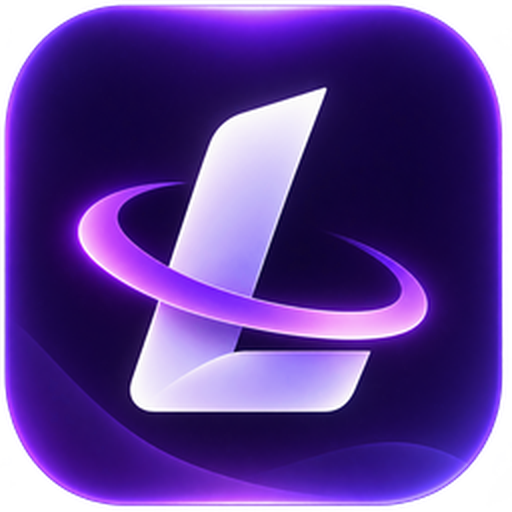

<h1 align="center">LumenCord</h1>

A sleek Discord client mod with tons of built-in plugins, gorgeous themes and a chill, polished design.

## What this is

LumenCord is built on Nightcord (itself a fork of
[Equicord](https://github.com/Equicord/Equicord), which builds on [Vencord](https://github.com/Vendicated/Vencord)).

A few things were changed from upstream Nightcord before this was rebranded:

- **Removed:** DM Bomb, Mass DM, Flood Panel, Surveillance, and the fake "official DM" plugin that injected
  messages pretending to be from Nightcord's team. These either exist purely to spam/harass other people, or to
  impersonate an official source.
- **Removed:** GhostClient, GhostInstaller, MultiInstance and TokenImporter. They saved Discord account tokens
  (which work like passwords) in plain files, and GhostInstaller downloaded and ran programs from Nightcord's server.
- **Removed:** every bit of code that silently talked to Nightcord's own servers: cloud sync, account linking,
  profile lookups, plugin likes, badges, tutorial videos, the status pinger and the runtime code downloader.
  LumenCord talks to Discord, to this GitHub repo (updates, changelog, badge list), to the LumenCord badge
  server once you verify for badges, and to outside services only when you turn on a plugin that needs one.
- **Fixed:** downloads and the DM Purger email login now check HTTPS certificates properly.
- **Removed:** the build-time code scrambling (obfuscation), so the source stays readable.
- **Removed:** hidden invisible-character watermarking that was in the original licence text.
- **Kept:** the other plugins, including some that only affect your own account and are used at your own risk
  (things like FakeVoice and Server Cloner). See `installer-src/assets/license.txt` for the terms.

## Installing

1. Upload this project to a GitHub repo (see `push-to-github.bat`).
2. GitHub Actions builds LumenCord, then builds the Windows installer, and puts both on the **latest** release.
3. Download **LumenCord-Installer.exe** from the [Releases page](https://github.com/8wmc/LumenCord/releases),
   run it, accept the licence, pick your Discord, and click Install.

The installer is Windows-only for now. Updates inside the app come only from this repo's GitHub releases.
Every upload to GitHub gets a new version number automatically (2.1.0, then 2.1.1, 2.1.2, ...), so installed copies
notice the update on their own.

## LumenCord Games

Click **LumenCord Games** in your DM list (under LumenCord AI) to play 20 free games inside Discord: arcade, cards,
puzzles, board games and word games. Your best scores are saved on your device. More games are coming in batches.

## LumenCord badges

Badges only LumenCord users can see. Everything about them is on **Settings → LumenCord Badges**.

- **Staff badges** (Owner, Developer, Admin, Helper, Donator) and **hand-out badges** (Friend, Met the Owner,
  Met Staff, Trusted Member, Hot Dog Lover, Big Back, That One Kid, Meat Rider, Glazer, Lemon) are given out by
  editing `badges.json` in this repo. Find an empty slot, paste the person's Discord user ID into `userId`, and put
  badge IDs in `badges`, e.g. `["helper", "lemon"]`. `username` and `displayName` are optional labels for you.
  The full badge list is at the bottom of the file. Save, then run `push-to-github.bat`; people see it within ~30 min.
- **Member stages** (50 of them over the first year) and **game-session stages** (10 of them, 30 minutes up to
  24 hours of one game) are automatic. They need the person to press **Verify with Discord** once.
  The live game badge goes away when they stop playing, and a "Last session" badge stays until they start a
  different game.

To get someone's user ID: Discord → Settings → Advanced → turn on Developer Mode, then right-click them → Copy User ID.

**What LumenCord stores and why:** To give out badges, we store your Discord user ID, username, display name, the
date you first opened LumenCord, and your current game session (game name and time played). This is only used to
show badges. It's kept privately and never sold or shared. You can turn badges off in Settings anytime, and your
data is deleted. (This lives in the LumenCord badge server on Cloudflare, never in this GitHub repo.)

## Building from source (Windows)

Double-click `build.bat`. It installs pnpm and builds LumenCord. The installer itself is built separately by
GitHub Actions (it needs Electron + native modules that are easiest to build in CI).

## Credits & licence

LumenCord is based on Nightcord, Equicord and Vencord, all free software licensed under the GNU General Public
License v3.0 or later. See [LICENSE](LICENSE). You're free to use, study, modify and redistribute LumenCord's
source code under those same terms.
